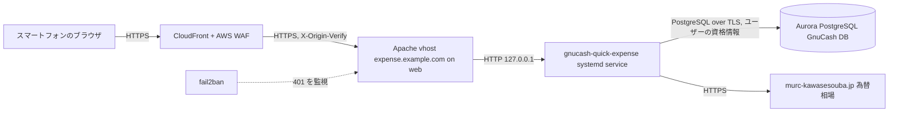

# gnucash-quick-expense 設計

## 目的

外出先のスマートフォンから、GnuCash の PostgreSQL データベース（Aurora）に支出を 1 件ずつすぐ記録するための Web フォームを作る。記録できるのは「支払い元の資産アカウントから、費用アカウントへ」という 2 split の取引だけで、GnuCash デスクトップ版の代わりにはしない。リポジトリ名もデスクトップ版と同じ機能があると思わせないよう `gnucash-quick-expense` とした。

ソースは GitHub の公開リポジトリ `rewse/gnucash-quick-expense` に置き、`rewse/ansible-playbooks` が GitHub から取得して web（`web.example.com`、Raspberry Pi、`home_primary`）にデプロイする。ansible-playbooks にはアプリのソースを置かない。

## ゴール、非ゴール、アンチゴール

ゴール:

- スマートフォンで、金額、日付、説明、減額アカウント、増額アカウントを入れてボタンを押すと、確認なしで取引が INSERT される。
- JPY 以外の現金で払った支出も、過去の取引と同じ形で記録できる。
- `https://expense.example.com/` として CloudFront と AWS WAF 経由でインターネットに公開する。

非ゴール:

- 取引の参照、更新、削除
- 3 split 以上の取引、振替、収入の記録
- ログイン状態の保持（セッション、Cookie）
- 英語以外の UI

アンチゴール（動いても失敗とみなすもの）:

- 金額を float で扱い、丸め誤差が帳簿に入る。
- PostgreSQL の資格情報がサーバーのディスク、ログ、Cookie、ブラウザのストレージに残る。
- 名前や README が GnuCash の代替アプリであるかのように見える。

## 制約

- DB スキーマは <https://wiki.gnucash.org/wiki/SQL> と `~/git/gnucash-import-agent/.kiro/skills/gnucash-import/references/gnucash-schema.md` に従う。INSERT の形は gnucash-import-agent が使っているものと同じにする。
- DB は PostgreSQL 16（Aurora）で、セッションのタイムゾーンは UTC。
- 接続先（server、port、database）は 1Password の `ansible` vault の item `<db-endpoint-item>`（タイトル `db.example.com (gnucash)`）にあり、Ansible の service account で読める。デプロイで使うのは `server`、`port`、`database` だけで、ユーザー名とパスワードはサーバーに置かない。`server` は `db.example.com`（Aurora のエンドポイントを指す CNAME）。
- フォームで入力する PostgreSQL ユーザーは、このアプリ専用のロール `expense-form` を使う（後述）。資格情報は 1Password の `Private` vault の item `<form-credentials-item>`（`GnuCash Quick Expense`）にある。
- ansible-playbooks の `AGENTS.md`（`roles/filebrowser` が参照実装）と、`~/git/AGENTS.md` の GitHub 設定ルールに従う。
- 公開リポジトリなので、個人のアカウント名、ホスト名、DB の接続先をコードや README に埋め込まない。これらは設定として Ansible から渡す。

## 既存データから分かったこと

2026-10-31 に DB を読み取り専用で確認した結果:

- 減額側の候補になるアカウントは 13 件。`Assets:<通貨>:Cash`（複数の通貨）、`Assets:Yen:Cash:Glovebox`、`Assets:Yen:Prepaid:Transit Card`。
- `Expenses` 配下は 114 件で、すべて JPY。使える（placeholder でも hidden でもない）ものは 101 件。
- JPY は `fraction` 1、それ以外の通貨は 100。
- 外貨の現金で払った過去の取引は、取引通貨が外貨、資産側 split が value = quantity（外貨）、費用側 split が value = 外貨、quantity = 円の金額（分母 1）になっている。円の金額は、その日の三菱 UFJ 銀行の TTM で換算した値に一致する。
- `post_date` はすべて `10:59:00`（UTC）。
- `prices` 表の外貨から JPY へのレートは通貨によって古いか、ほとんどない（通貨によっては数年前の価格しかないか、1 件もない）。そのため換算の主な取得元にはせず、公表相場が取れない通貨の代わりにだけ使う。

## 方式の検討

| 方式 | 内容 | 判断 |
|---|---|---|
| A. PyPI と uvx | enecoq-data-fetcher と同じく PyPI に公開し、systemd から `uvx` で起動する | 不採用。Web アプリを PyPI に置くことに違和感があるため。enecoq-data-fetcher に合わせたかったのは「ソースを ansible-playbooks に置かない」点だけだった |
| B. コンテナ | GHCR に arm64 イメージを公開し、`/etc/compose/<role>/compose.yaml` で動かす | 不採用。web の常駐サービスと同じ形にできるが、イメージのビルドと公開のワークフロー、ベースイメージの更新管理が増える。小さいフォーム 1 つには重い |
| C. checkout と systemd | Ansible が GitHub のリポジトリを `/opt/gnucash-quick-expense` に checkout し、`uv sync --locked` を実行して systemd で起動する | **採用**。ansible-playbooks の決まり（チェックアウトしたまま動かすソフトは `/opt/<name>`、自分のリポジトリはクールダウンなしでデフォルトブランチを追う、自分の lockfile に対する `uv sync` はクールダウンの対象外）にそのまま当てはまる。弱点は、playbook を実行した時点の main がそのまま動くこと |

## 全体構成

## 画面と操作

画面は 1 ページで、UI はすべて英語にする。

1. ページを開くと、`Username` と `Password` の入力欄だけが使える。入力欄には `autocomplete="username"` と `autocomplete="current-password"` を付け、1Password の自動入力が効くようにする。
2. 資格情報を入れて `Sign in` を押すと、サーバーがその資格情報で DB に接続し、アカウント一覧を返す。認証に失敗したらエラーを表示する。
3. 入力欄が使えるようになる。
   - `Amount`: 小数も入れられるテキスト欄（`inputmode="decimal"`）。
   - `Date`: 画面を開いた日（JST）がデフォルトで、変更できる。時刻の欄はない。
   - `Description`: デフォルトは空欄。
   - `From`（減額アカウント）: 普通のプルダウン。デフォルトは `Assets:Yen:Cash`。
   - `To`（増額アカウント）: テキスト欄に入力すると、部分一致で候補を絞り込むプルダウンが出る。デフォルトは `Expenses:Food:Dining`。候補にないパスでは送信できない。
   - `Amount in JPY`: `From` の通貨と `To` の通貨が違うときだけ表示する（後述）。
4. `Add` を押すと、確認なしで INSERT する。成功したら、記録した内容（日付、金額と通貨、From、To）を表示する。

資格情報は、開いているページの JavaScript の変数にだけ持つ。Cookie、localStorage、sessionStorage には書かない。送信のたびに資格情報を一緒に送り、サーバーはそのリクエストの間だけ DB に接続する。

## アカウント一覧

アクセスのたびに `accounts` 表から作る。パスは `Root Account` を起点に `:` でつないだもので、表示するときは先頭の `Root Account:` を省く。自分の `placeholder` か `hidden` が 1 のアカウントは候補から外す。

- 減額側: `Assets:` で始まり、最後の要素が `Cash`、`Transit Card`、`Glovebox` のどれかであるアカウント（`Assets:**:Cash` などのパターンの意味）。
- 増額側: `Expenses:` で始まるアカウント（`Expenses:**`）。

減額側のパターン、増額側のパターン、2 つのデフォルトは、コードから切り離した YAML の設定ファイルに書く。リポジトリには個人の値を含まない例 `config.yaml.example`（enecoq-data-fetcher と同じ名前の付け方）だけを置き、web の実際の設定ファイルは Ansible がテンプレートから作って、上の値を埋める。アプリは起動時に設定ファイルのパスを受け取る（引数か環境変数。パスは builder に任せる）。読み込みには PyYAML の `safe_load` を使う（自分の判断）。パターンの書き方は、ユーザーが使った `Assets:**:Cash` の形をそのまま書けるようにする（`**` は任意の深さの階層）。

一覧はパスのアルファベット順に並べる（自分の判断）。デフォルトのアカウントが見つからないときは、未選択にして送信できないようにする（自分の判断）。

## 金額と通貨

金額は float を使わずに、GnuCash と同じく分子と分母の整数で扱う。

- 取引の通貨は、減額アカウントの commodity にする。分母はその通貨の `commodities.fraction`（JPY は 1、USD などは 100）。
- 入力は文字列のままサーバーに送り、サーバーで 10 進数として解釈する。正の数だけを受け付け、小数の桁数が分母より多い（JPY で小数を入れた、USD で 3 桁目まで入れた）ときはエラーにする。区切りのカンマは、ブラウザが送信前に取り除く。サーバーはカンマを含む値をエラーにする。
- 減額側 split は value = quantity = −金額。増額側 split は value = +金額。
- 増額アカウントの commodity が取引の通貨と同じなら、増額側の quantity = value。
- 違うとき（外貨の現金から JPY の Expenses に払った場合）は、増額側の quantity を `Amount in JPY` の値にする。分母は増額アカウントの commodity の fraction を使う。

## 為替レート

`Amount in JPY` には、三菱 UFJ リサーチ＆コンサルティングの公表相場から計算した値を自動で入れる。値は手で書き換えられる。

- 取得元は `https://www.murc-kawasesouba.jp/fx/past_3month_result.php?y=YYYY&m=M&d=D`。1 ページにその日の全通貨の TTS、TTB、TTM の表がある。ページの文字コードは Shift_JIS。`c` パラメータは不要。
- 使うのは TTM。
- 選んだ日付にレートの表がない（土日祝日、公表前）ときは、1 日ずつさかのぼって直前の平日のレートを使う。さかのぼる上限は builder が決める。
- KRW や IDR など一部の通貨は「100 通貨単位の円相場」。どの通貨が 100 単位かはページの注記から読み取り、1 通貨単位に直して計算する。
- 円の金額は「金額 × TTM」を 1 円単位で四捨五入する（自分の判断）。計算はサーバーで 10 進数を使って行い、結果を文字列で返す。
- TWD と MOP はこのページで公表されていない。この 2 通貨と、ページからレートを取得できなかったときは、GnuCash の `prices` 表から、その通貨から JPY へのレートのうち日付が選んだ日以前で最新のものを使う。`prices` 表にもないときは欄を空欄にし、手入力を求める。空欄のままでは送信できない。
- `Amount in JPY` の横に、使ったレートの出どころ（`MUFG TTM` か `GnuCash price`）と日付を表示する。`prices` 表のレートは数か月前のものになることがあるため。
- 金額、日付、減額アカウントのどれかが変わったら計算し直す。ユーザーが手で書き換えた後に金額などが変わったときは、計算した値で上書きする（自分の判断）。
- 同じ日付のレートはサーバーのメモリにキャッシュしてよい。
- レートを取る API も、DB の資格情報で認証できたリクエストにだけ応える。認証なしで外部サイトへの取得を中継させないため。

## INSERT する内容

1 つの DB トランザクションで、`transactions` 1 行と `splits` 2 行を入れる。

| 表 | 列 | 値 |
|---|---|---|
| transactions | `guid` | `uuid.uuid4().hex` |
| transactions | `currency_guid` | 減額アカウントの `commodity_guid` |
| transactions | `num` | `''` |
| transactions | `post_date` | 選んだ日付の `10:59:00`（UTC として保存） |
| transactions | `enter_date` | 送信時刻（UTC） |
| transactions | `description` | 入力値。空欄なら `''` |
| splits | `guid` | `uuid.uuid4().hex` |
| splits | `memo`、`action` | `''` |
| splits | `reconcile_state` | `n` |
| splits | `reconcile_date`、`lot_guid` | `NULL` |

`reconcile_state` を `n` にするのは、gnucash-import-agent が明細を取り込むときに、同じ金額の `n` の取引があれば重複して INSERT せず `c` に変えるため。Suica などの明細と後で突き合わせられる。

SQL はすべてパラメータ化する。アカウントの GUID はクライアントから受け取らず、送られたパスを、その場でサーバーが作った候補一覧と照らして解決する（自分の判断）。これにより候補外のアカウントには書き込めない。

GnuCash デスクトップ版を開いたままでも INSERT はできるが、デスクトップ版の画面には開き直すまで反映されない。gnucash-import-agent と同じく、`slots` 表には何も書かない。

## サーバー

自分の判断で、次の構成にする。

- Python。バージョンは `.python-version` で決める。パッケージ管理は uv。
- Web フレームワークは Starlette と uvicorn。DB ドライバーは psycopg 3。レートの取得は httpx。設定ファイルの読み込みは PyYAML。
- フロントエンドはビルドの要らない HTML、CSS、素の JavaScript だけにする。ライブラリをサードパーティの CDN（jsDelivr など）から読み込まず、すべて自分のサーバーから配信する。CSP を `'self'` に絞れるようにするため。部分一致の候補リストは、iOS Safari の `datalist` が部分一致で絞り込まないことがあるため、自前の小さなコンボボックスで作る。
- `127.0.0.1` の固定ポートで待ち受ける。ポート番号は web で使われていないものを builder が選ぶ。
- DB への接続は TLS を必須にする。`db.example.com` は CNAME なので、`verify-full` にするとホスト名が証明書と一致しない。`sslmode` と CA バンドルの扱いは builder が確かめて決める。
- 接続先の server、port、database は環境変数で渡す。

エンドポイントの形は builder に任せる。満たすべき条件は次のとおり。

- 資格情報は POST の JSON 本文でだけ受け取る。URL のクエリやヘッダーには載せない。
- DB の認証に失敗したら（SQLSTATE `28P01` と `28000`）HTTP 401 を返す。fail2ban はこれを数える。
- 入力の誤りは 400、それ以外の失敗は 500 を返す。エラーメッセージに資格情報や SQL を含めない。
- ログに資格情報、リクエスト本文を出さない。uvicorn のアクセスログは Apache と重複するので止めてよい。
- レスポンスに `Content-Security-Policy`（`default-src 'self'` 相当）、`X-Content-Type-Options: nosniff`、`Referrer-Policy: no-referrer` を付ける。API のレスポンスには `Cache-Control: no-store` を付ける。
- 静的ファイル（CSS、JavaScript）は、ファイル名か URL にバージョンを入れて、長めの `Cache-Control: max-age` でブラウザにキャッシュさせる（自分の判断）。CloudFront ではキャッシュしない。今のディストリビューションは web の全ホストで共有していて、Managed-CachingDisabled を使っている。キャッシュの振る舞いはパスで分けるのでホスト名ごとには変えられず、このアプリだけキャッシュを有効にできないため。静的ファイルは数 KB なので、ブラウザのキャッシュで足りる。
- Cookie を使わないので CSRF トークンは要らない。ただし API は `Content-Type: application/json` 以外を拒否する。

## リポジトリ `rewse/gnucash-quick-expense`

- GitHub の公開リポジトリ。MIT の `LICENSE`、英語の `README.md`、`AGENTS.md` を置く。README では、できることが支出 1 件の追加だけで、GnuCash のすべての機能を提供するものではないことを最初に書く。
- `.github` と `.pre-commit-config.yaml` は `~/git/AGENTS.md` のルールに従う（dependabot の github-actions、uv、pre-commit エントリ、`gitleaks.yml`、`trufflehog.yml`、`dependency-scan.yml`、`lint.yml`、`test.yml`）。リリースはしないので `release.yml` とタグの ruleset は作らない。
- 依存パッケージには 96 時間のクールダウンを守る（`[tool.uv] exclude-newer = "4 days"`）。
- テストは pytest で書く（自分の判断）。少なくとも、金額の解釈と分子・分母への変換、為替ページの解析（100 通貨単位、土日のさかのぼり）、アカウントのパターンの絞り込み、INSERT する行の組み立てをテストする。為替ページは保存した HTML で、DB は組み立てる行の単位でテストする。

## デプロイ（`rewse/ansible-playbooks`）

新しいロール `gnucash_quick_expense` を作り、`home-primary.yml` に追加する。構成は `roles/filebrowser` にならう。

- `source`: GitHub のデフォルトブランチの最新コミットを解決して（自分のリポジトリなのでクールダウンなし）、`/opt/gnucash-quick-expense` に checkout する。その後 `uv sync --locked` を実行する。
- `service`: systemd ユニット。専用ユーザーで動かし、`ProtectSystem=strict`、`NoNewPrivileges=true` などで書き込みと権限を絞る。環境変数ファイルで接続先とアカウントの設定を渡す。ソースやロックファイルが変わったら再起動する。失敗時は他のユニットと同じく `OnFailure=failure-notify@%n.service` を付ける。
- `apache`: `expense.example.com` の vhost。filebrowser の vhost と同じく TLS を終端し、`X-Forwarded-*` と `X-Real-IP` の扱いを揃えたうえで `127.0.0.1` に proxy する。
- `fail2ban`: `expense.example.com` への API の POST が 401 になったら数えるフィルターと jail。filebrowser と同じく `other_vhosts_access.log` を見て、`apache-deny` アクションを付ける。
- 接続先は `op://<vault>/<db-endpoint-item>/` の `server`、`port`、`database` から読む。
- アカウントの設定ファイルをテンプレートから作る。値はロールの変数に置く。
- TLS 証明書は既存の `/etc/letsencrypt/live/example.com`（`example.com` と `*.example.com`）がそのまま使える。

## PostgreSQL ロール

フォームで使う専用のロール `expense-form` を 2026-10-31 に作成済み。パスワードは SCRAM-SHA-256 のハッシュをクライアント側で作ってから送ったので、平文は DB のログに残らない。権限は次のとおり。

- `LOGIN`、`NOSUPERUSER`、`NOCREATEDB`、`NOCREATEROLE`、`NOREPLICATION`、`CONNECTION LIMIT 5`
- `gnucash` データベースへの `CONNECT`、`public` スキーマの `USAGE`
- `accounts`、`commodities`、`prices` の `SELECT`
- `transactions`、`splits` の `INSERT`

`PUBLIC` からは、`gnucash` データベースのすべての権限（`CONNECT`、`TEMPORARY`）と、`public` スキーマの `CREATE` を取り上げた。データベースの所有者とマスターユーザーは影響を受けない。`expense-form` で接続して、上の操作ができることと、`transactions` の SELECT、`splits` の UPDATE と DELETE、`slots` の SELECT、`public` へのテーブル作成、一時テーブルの作成が拒否されることを確かめた。

アプリは `transactions` と `splits` を SELECT できないので、INSERT の前に GUID の重複を確かめない。uuid4 の衝突は無視できるほど起きにくく、万一重複しても主キーの制約で INSERT が失敗するだけで済む。

## CloudFront（`rewse/cloudfront-waf`）

`infra/template.yaml` の名前リストとテストに `expense.example.com` を足して、スタックをデプロイし直す。直近のコミット `0c4a5bf feat: serve zabbix-mcp.example.com through CloudFront` と同じ作業で、DNS の切り替えは `docs/setup.md` に従う。

## builder に任せること

- コードの構成、モジュール分割、エンドポイントの URL
- 画面のレイアウトとスタイル（スマートフォンで片手で使えること）
- 待ち受けポート番号、systemd のハードニングの細かい設定
- 為替レートを何日さかのぼるかの上限、キャッシュの持ち方
- DB 接続の `sslmode` と CA バンドル
